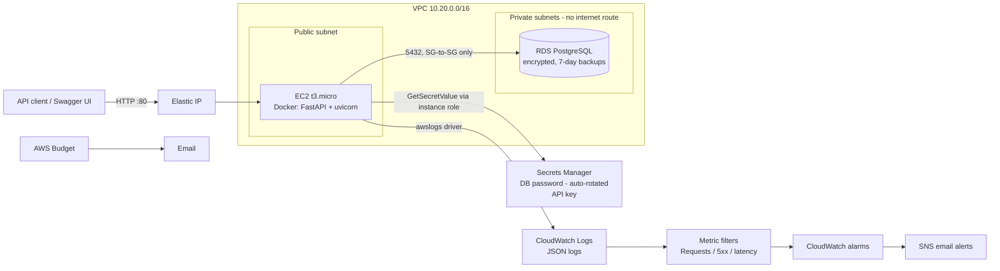

# Project 1 — Cloud-Hosted Business API (BrightMart Inventory & Orders)

Arrowstack Cloud Computing Internship · Foundation / Core Industry Task

A containerised REST API for a simulated retail business, **BrightMart**. It is deployed on AWS with a
managed PostgreSQL database, secrets kept in Secrets Manager, private networking, structured logging,
alarms, automated backups and a cost budget. All of it is defined in one CloudFormation template.

| | |
|---|---|
| **Stakeholder** | BrightMart store-operations team (inventory managers, order desk) |
| **Problem** | Stock is tracked in spreadsheets, so items get oversold and nobody gets warned about low stock |
| **Solution** | An API that records products and orders, **refuses orders that would oversell**, and reports low-stock items |
| **Stack** | Python 3.12 · FastAPI · SQLAlchemy · Docker · EC2 (t3.micro) · RDS PostgreSQL (db.t4g.micro) · Secrets Manager · CloudWatch · SNS · AWS Budgets · CloudFormation |

## Architecture



More detail: [docs/architecture.md](docs/architecture.md)

## How each requirement is covered

| Handbook requirement | Implementation | Evidence |
|---|---|---|
| IAM least privilege | Instance role can read **only its two secrets** and write **only its own log group**. No SSH; access through SSM Session Manager. DB security group accepts traffic only from the app security group | [infra/template.yaml](infra/template.yaml) `InstanceRole`, [docs/architecture.md#security](docs/architecture.md#security--iam) |
| Configuration / secrets management | Only secret **ARNs** are passed in as env vars. The RDS password is managed and auto-rotated by RDS, and the app re-reads it after a rotation | [app/config.py](app/config.py), [app/db.py](app/db.py), [tests/test_db_rotation.py](tests/test_db_rotation.py) |
| Monitoring / logging | JSON request logs with request IDs → CloudWatch. Metric filters, 6 alarms, a dashboard, EC2 auto-recovery | [docs/operations-runbook.md](docs/operations-runbook.md) |
| Backup / recovery plan | RDS daily backups + 7-day point-in-time restore, final snapshot on delete, written restore runbook with RTO/RPO | [docs/operations-runbook.md#backup--recovery](docs/operations-runbook.md#backup--recovery) |
| Cost-awareness notes | Free-tier sizing, no NAT gateway, log retention limits, $5 budget alarm | [docs/cost-notes.md](docs/cost-notes.md) |
| Edge cases / invalid input | Validation (422), auth (401), duplicate SKU (409), oversell (409, atomic), FK-protected delete (409), row locking for concurrent orders | [tests/](tests/), [docs/test-evidence.md](docs/test-evidence.md) |

## Run locally (no AWS needed)

```bash
python -m venv .venv
.venv\Scripts\activate            # Windows  (macOS/Linux: source .venv/bin/activate)
pip install -r requirements-dev.txt
pytest --cov=app                  # 35 tests, 97% coverage
uvicorn app.main:app --reload     # open http://127.0.0.1:8000/docs
```

Locally the app uses SQLite, and the API key is `local-dev-key`. Send it as the `X-API-Key` header on POST, PATCH and DELETE requests.

## Deploy to AWS

**Prerequisites:** an AWS account, the [AWS CLI v2](https://aws.amazon.com/cli/) configured with `aws configure`, and this repository pushed to a **public** GitHub repo. The EC2 instance clones that repo and builds the Docker image itself, so you don't need Docker on your laptop.

```powershell
.\scripts\deploy.ps1 -GitRepoUrl https://github.com/PedJay/ArrowStack_Internship_Project1_Cloud_Hosted_Business_API.git -AlertEmail you@example.com
```

1. Wait about 15 minutes. The stack only reports success once the API's `/health/ready` passes on the instance (via a CloudFormation `CreationPolicy`).
2. Confirm the **SNS subscription email** that AWS sends you.
3. Run the end-to-end check against the cloud deployment:
   ```powershell
   $key = aws secretsmanager get-secret-value --secret-id brightmart-api/api-key --region ap-south-1 --query SecretString --output text
   python scripts/smoke_test.py --base-url http://<ApiUrl-output> --api-key $key
   ```
4. Open `http://<ApiUrl>/docs` for the Swagger UI and the `DashboardUrl` output for CloudWatch.

| Task | Command |
|---|---|
| Ship new code (no infra change) | `.\scripts\redeploy_app.ps1` (runs `git pull` → `docker build` → restart via SSM) |
| Shell on the instance | `aws ssm start-session --target <InstanceId>` |
| Tear everything down | `.\scripts\teardown.ps1` (a final RDS snapshot is kept) |

> ⚠️ **Delete the stack when you're done demoing.** See [docs/cost-notes.md](docs/cost-notes.md).

## Repository layout

```
app/                FastAPI application (config, db, models, schemas, routers)
tests/              pytest suite (SQLite + moto-mocked Secrets Manager)
infra/template.yaml CloudFormation: VPC, EC2, RDS, IAM, secrets, alarms, dashboard, budget
scripts/            deploy / redeploy / teardown / smoke_test
docs/               requirements, architecture, runbook, cost notes, decisions, test evidence, work log
evidence/           generated test + smoke-test reports, screenshots
```

## API summary

| Method | Path | Auth | Purpose |
|---|---|---|---|
| GET | `/health` | – | Liveness (process up) |
| GET | `/health/ready` | – | Readiness (DB reachable) |
| GET | `/products?low_stock=true&limit=&offset=` | – | List / low-stock report |
| POST · PATCH · DELETE | `/products[/{id}]` | API key | Manage catalogue |
| POST | `/orders` | API key | Place order (atomic stock check + decrement) |
| GET | `/orders`, `/orders/{id}` | – | Order history |

## Known limitations

Plain HTTP with no TLS, a single instance, a single-AZ database, and the app connecting as the DB master user. These are documented, with a roadmap, in [docs/architecture.md#limitations--roadmap](docs/architecture.md#limitations--roadmap).
